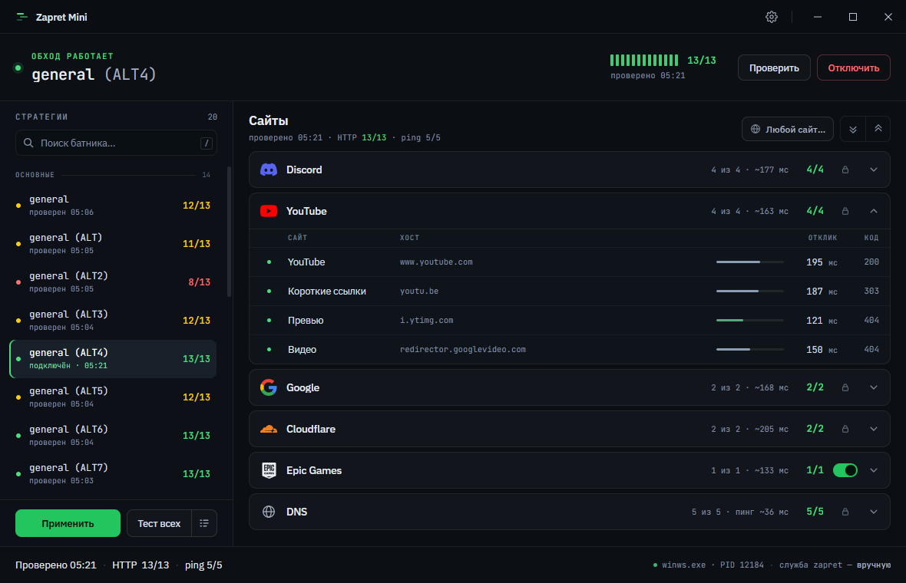

# Zapret Mini

Панель управления обходом блокировок для Windows на базе
[zapret-discord-youtube](https://github.com/Flowseal/zapret-discord-youtube).



## Возможности

- Перебор и применение стратегий zapret, группы ALT / FAKE TLS AUTO / SIMPLE FAKE.
- Проверка сайтов по категориям: Discord, YouTube, Instagram, Google, Cloudflare,
  Epic Games, DNS.
- «Тест всех» с итоговым рейтингом и кнопкой «Применить лучший».
- «Любой сайт…»: временно добавляет домен в пользовательский обход, перебирает
  стратегии, сохраняет рабочий вариант и показывает сайт отдельной карточкой.
- Встроенные сервисы защищены от отключения; добавленные сайты можно выключать
  свитчем и удалять.
- Автопроверка обновлений приложения через GitHub Releases.
- Автопроверка обновлений сборки zapret из
  [Flowseal/zapret-discord-youtube](https://github.com/Flowseal/zapret-discord-youtube):
  батники, `bin` и стандартные списки обновляются, пользовательские targets и
  списки сохраняются.
- Удаление через Windows «Параметры → Приложения» или через настройки приложения.

## Установка

1. Скачай свежий релиз zapret:
   [Flowseal/zapret-discord-youtube/releases](https://github.com/Flowseal/zapret-discord-youtube/releases).
   Распакуй, например, в `C:\zapret`.
2. Скачай `ZapretMini-<версия>-win-x64.zip` из
   [Releases](https://github.com/DigerPro/zapret-mini/releases).
3. Распакуй приложение, например, в
   `%LOCALAPPDATA%\Programs\ZapretMini` и запусти `ZapretMini.exe`.
4. Подтверди UAC. Приложение само найдёт папку zapret на рабочем столе,
   в загрузках или в `C:\zapret`. Если не нашло — укажи папку в настройках.
5. При первом запуске создаётся задача автозапуска без UAC.

Приложение не подписано сертификатом. SmartScreen может предупредить:
«Подробнее» → «Выполнить всё равно». `winws.exe` из zapret требует WinDivert и
может вызвать предупреждение антивируса — это часть zapret.

## Обновления

- **Приложение** проверяет `releases/latest` этого репозитория. Если версия новее,
  предлагает скачать и установить её. Настройки, список сайтов и папка zapret не
  затрагиваются.
- **Батники zapret** проверяются через GitHub API Flowseal. Обновление заменяет
  `bin`, `.bat` и стандартные списки, но сохраняет:
  - `utils\targets.txt` — пользовательские сайты и группы;
  - `lists\list-general-user.txt`;
  - `lists\list-exclude-user.txt`;
  - `lists\ipset-exclude-user.txt`;
  - дополнительные `.bat`-файлы пользователя.
- Оба обновления можно проверить вручную: «Настройки → Обновления».

## Удаление

- Windows: **Параметры → Приложения → Zapret Mini → Удалить**.
- Или в приложении: **Настройки → Удаление → Удалить**.

Удаляются приложение, настройки, список сайтов и управляемая папка zapret в
`%LOCALAPPDATA%\ZapretMini`. Папка zapret, выбранная вручную вне этой директории,
не удаляется.

## Сборка

```powershell
npm ci
npm test
npm run pack
```

Готовое приложение: `release\win-unpacked`.

## Лицензия

Код этого приложения — MIT, см. [LICENSE](LICENSE).

Сборка zapret, `winws.exe`, WinDivert и батники принадлежат их авторам:
[Flowseal/zapret-discord-youtube](https://github.com/Flowseal/zapret-discord-youtube)
и [bol-van/zapret](https://github.com/bol-van/zapret). Они не входят в этот
репозиторий и распространяются по своим лицензиям.
